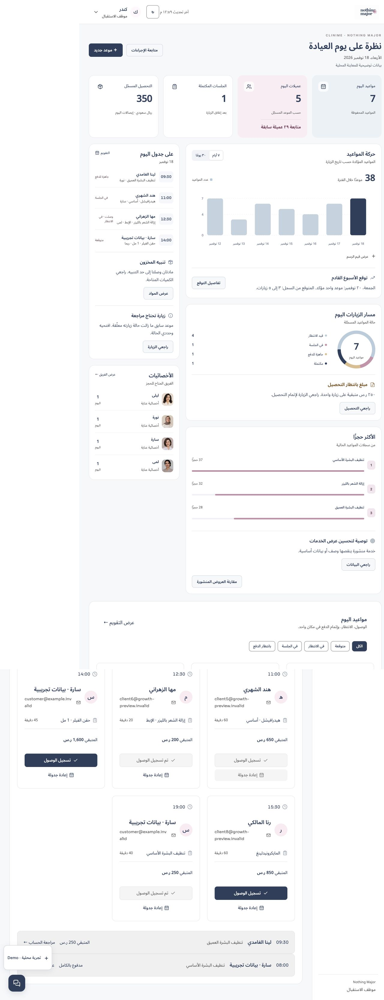

# Clinime — Customer & Admin

كل واجهات كلينيمي للعميلة والإدارة، مع نسخة تجربة محلية **بدون إيميل أو كلمة مرور**. تشمل الكود والصور والخطوط ونظام التصميم وحالات الواجهة والاختبارات.

## Run in two steps

Install **Node.js 22 or newer**, then run from this folder:

```sh
npm ci
npm start
```

Open **[http://127.0.0.1:4173/demo](http://127.0.0.1:4173/demo)** and choose Customer or Admin. No account, API key, environment file or cloud service is required. If the port is occupied, stop the previous preview or use the port override documented in [the demo guide](docs/DEMO.md).

- **Customer:** discovery, service selection, specialists, booking, appointments, profile, loyalty card, rewards/gifting, referrals, wallet and Care Point.
- **Admin:** accepted dashboard with recommendations, appointments and sessions, services, specialists, reviews, marketing, loyalty, referrals, Care Point awards, products, supplies, stock and clinic management.
- **States:** populated, empty, slow/loading, recoverable error and insufficient-history scenarios, plus the original authentication screens through an optional guest session.
- **Design system:** editable tokens, icons, fonts, brand sources, component/state contracts and an interactive Arabic/English light/dark specimen.

The default demo shares one synthetic clinic between Customer and Admin tabs. Appointments and staff edits use the included business logic. Its data is fictional and resets when the server restarts. Email and Wallet delivery are simulated locally; no real message, payment, pass update or prize transfer occurs.

## Preview



[Customer rewards screenshot](docs/images/customer-rewards.jpg) · [Executed checks](docs/RELEASE-VERIFICATION.md)

## Where to start

| Need | File or folder |
| --- | --- |
| Try the complete flows | [Demo guide](docs/DEMO.md) |
| Find a screen or state | [Screen and state inventory](docs/SCREENS-AND-STATES.md) |
| Customer UI | [`client/`](client/) |
| Admin UI | [`client/admin/staff/`](client/admin/staff/) |
| Business logic and original API | [`server/`](server/) |
| No-login demo adapter | [`scripts/demo-server.mjs`](scripts/demo-server.mjs) |
| Images, logos and fonts | [`assets-source/`](assets-source/), [`client/service-photos/`](client/service-photos/), [`client/specialist-photos/`](client/specialist-photos/) |
| Design system | [`design-system/`](design-system/) |
| Architecture and API | [`docs/engineering/`](docs/engineering/) |
| Verification and release scope | [Release notes](docs/RELEASE-NOTES.md) |

## Development checks

```sh
npm run build
npm run check
npm test
npm run scan:public
```

`npm run build` emits the original static Customer, Admin and game bundles into `dist/`. The no-login behavior belongs to the separate local demo server; production API authentication is retained. Generated files and local demo records are not committed.

## Using this for another clinic

The repository can be cloned or downloaded without a GitHub account. The local demo runs without signing in. Connecting a real clinic requires its own storage, secure staff/customer access, provider accounts and operational configuration; see [deployment boundaries](docs/engineering/HANDOFF-STATUS-AND-MIGRATION.md) and [`.env.example`](.env.example).

There are no production credentials or customer database exports in this repository. `netlify/` contains the original adapter source, and this release does not publish or change the live clinic. Maeen retains its accepted **Coming Soon** screen; experimental tools are source code, not an active autonomous marketing service.

This is a public source handoff. Supplied Clinime identity and third-party assets retain their provenance and applicable rights; font and icon license texts are included. A public repository is not a grant of third-party trademark or asset rights.
