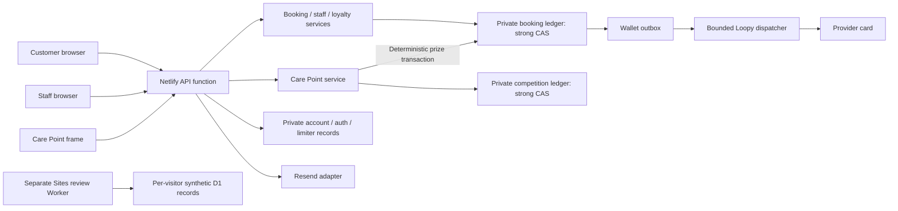

# Clinime architecture

Source inspection: 2026-11-15. This describes the source supplied for handoff, not a fresh production verification. No production configuration, private store, customer record, provider account, or secret file was accessed for this document.

## Source map and authority

In this archive, the application root is [`../../`](../../). The isolated review application is [`../03-Admin-Review/clinime-admin-review/`](../03-Admin-Review/clinime-admin-review/). Paths below beginning `server/`, `client/`, or `netlify/` are relative to the application root. Treat executable source as authoritative when older README files, rollout notes, screenshots, or prior deployment reports disagree.

| Area | Current source | Responsibility |
|---|---|---|
| Customer application | `client/{engine,journey,muse,loyalty,care-point,view}.js` | Service discovery, booking, account, rewards, embedded game; Arabic/English presentation |
| Staff application | `client/admin/staff/{bootstrap,bridge,team,dashboard}.js` | Auth bootstrap, server DTO projection, receptionist/manager/doctor work views and actual commands |
| Staff feature modules | `client/admin/staff/{marketing,loyalty,care-point,reviews,growth-data,growth}.js` | Feature views; some routes deliberately remain previews or coming-soon surfaces |
| API composition | [`server/api.mjs`](../../server/api.mjs) | Routing, authorization, Origin/CSRF checks, limits, dependency injection, safe responses |
| Domain services | `server/{bookings,staff,loyalty,visit-rewards,care-point}.mjs` | Booking/visit state, inventory, rewards and competition rules |
| External delivery | `server/{mail,loopy,wallet-events,wallet-dispatch,care-prize-mail}.mjs` | Email acceptance, provider enrollment, durable intents, delivery/reconciliation |
| Production host adapter | `netlify/functions/api.mjs` | Private Netlify Blobs, configured mail, bounded post-response Wallet work |
| Scheduled recovery | `netlify/functions/{wallet-sweep,care-point-sweep}.mjs` | Recover pending Wallet work; freeze ended competition weeks |
| Build | `scripts/build.mjs`, `netlify.toml`, `package.json` | Static assets, hashed bundles, `/admin`, `/game`, redirects and response headers |
| Independent demo host | Review application `worker/{runtime,store}.mjs`, `vendor/server/`, `drizzle/` | Synthetic per-visitor D1 data using a copied API; isolated from live clinic state |

The source package pins `@netlify/blobs` and targets Node 22 or later. It uses plain JavaScript browser modules/scripts and a Node Request/Response API, not a database ORM or a frontend framework. Customer scripts are concatenated in an explicit build order. Staff assets are copied under a content-versioned `/assets/admin-<hash>/` prefix; the build rewrites their source URLs. The game has its own entry and shared puzzle engine.

The original workspace build resolved some brand, imagery and font inputs from adjacent design/exploration outputs. The portable handoff copy collects those inputs under `assets-source/{brand,imagery,fonts}`. Follow the archive's build instructions and the delivered build script; do not assume the original workstation layout exists on another machine.

## Identity, access and privacy

[`server/auth.mjs`](../../server/auth.mjs) normalizes and verifies email through an emailed six-digit code or magic link. There is no password, phone login, client role token, or development-code bypass in this backend. Both verification methods consume the same challenge atomically. Challenges expire after ten minutes and lock after five failed attempts. The server cookie is `__Host-clinime-session`, HttpOnly, Secure, SameSite=Lax, host-only and path `/`; sessions last seven days and are revoked server-side on logout.

Account IDs derive from a secret-keyed HMAC of normalized email. Profile edits change the display name, not identity email. Rotating the secret changes identity derivation as well as invalidating authentication; this requires a migration plan, not a blind environment edit.

| Server audience | Enforcement |
|---|---|
| Public | Configuration, public service media, public slot lookup, public competition projection |
| Customer | Valid server session; booking lists/mutations are scoped to immutable `ownerId` |
| General staff administration | `createAdmin.authorize`: default exact configured email allowlist, or the explicitly configured `verified-email` enrollment policy |
| Competition administration | Additional configured-email allowlist check in `careOwner`, even when general staff access allows every verified email |
| Staff work-mode picker | Browser presentation state only; it does not grant server permissions or restrict a verified administrator to a clinical role |

The `verified-email` staff setting is broad: any OTP-verified account can reach general staff endpoints, including the private workspace. It is not a receptionist/doctor/manager permission model. The handoff does not assert this is appropriate for a real clinic. Review the actual configured policy with the owner before onboarding real staff.

Mutations require the exact configured HTTPS Origin and, after login, the session's `X-CSRF-Token`. Auth request/verify precede the CSRF gate but still require Origin. Limits use trusted host context rather than a client-provided forwarded-IP header. Staff/customer response projectors intentionally omit private ownership, request fingerprints, frozen email bodies and clinical state from customer DTOs. Public media is an exception: uploaded service imagery is publicly retrievable by its content hash; it is unsuitable for clinical attachments.

## Persistence and transaction boundaries

Production uses the private named Blobs store `clinime-private-v1`. `server/core.mjs` performs strong metadata reads and conditional `onlyIfNew` / `onlyIfMatch` writes. A missing ETag or lost acknowledgement fails closed. The bounded retry loop makes at most sixteen CAS attempts. No read-then-write pseudo-lock replaces this contract.

Most business facts share `clinic/booking-ledger-v1`: reservations, private staff visit state, manual receipts, catalog/inventory, loyalty, visit stamps, credit transactions and the Wallet outbox. This allows a reservation, pricing snapshot, reward reservation and idempotency receipt to commit together. It also creates a single hot record and a shared size/throughput ceiling. The competition has a separate ledger; crediting its prize uses a deterministic cross-ledger recovery protocol rather than pretending the two writes are one transaction.

Request UUIDs identify operations, not clicks. Booking, workspace, loyalty and competition services each maintain scoped operation receipts/fingerprints. A retry after a network timeout or `STORE_UNAVAILABLE` must retain the same UUID and identical payload. A changed body with an already accepted UUID is a conflict. Refresh/review and an intentional new operation are necessary after a revision conflict. Some replay responses project current state rather than reproducing an old byte-identical DTO.

## Independent domain facts

| Fact | Authoritative fields / event | What it does not prove |
|---|---|---|
| Reservation | `booking.status`, `date`, `time`, `revision`, frozen items/pricing | Arrival, treatment or payment |
| Arrival | `booking.attendance` | Medical consent, completion or a collected payment |
| Contact response | `_staff.attendanceResponse` | Physical arrival or a rescheduled reservation |
| Clinical decision | `_staff.decision` | Actual cancellation/rescheduling |
| Treatment | `_staff.stage`, `startedAt`, `finishedAt` | External payment acceptance |
| Manual collection | `staff.receipts` | Gateway charge, bank settlement or tax invoice |
| Visit closure | `stage:'closed'` with exact zero balance | A gateway callback; no gateway exists here |
| Wallet synchronization | Durable outbox/provider receipts | Creation or cancellation of the underlying reservation |

**Current-source correction:** arrival is no longer restricted to the scheduled calendar day. Session start requires confirmed booking, recorded arrival, three explicit clinical review flags and a proceed decision/start intent, but currently has no scheduled-day, opening-hours or reservation-overlap gate. Another unfinished session for the same configured specialist still blocks start, including an unfinished historical session. Different configured specialists use separate active-session resources; unknown/legacy assignments share a fallback resource. Additions/extensions still use strict planned/actual interval checks. Older descriptions of a single global active session, automatic next-day release, or `START_TIME_CONFLICT` as a current server response are stale for this source.

Reservation availability remains a shared-room calendar: `canBook` checks all confirmed bookings, not just the chosen specialist. Selecting `any` assigns an active specialist using booking counts with a deterministic tie-break. This distinction between calendar capacity and active-session resource locking must be preserved or deliberately redesigned.

## Boundaries and unfinished surfaces

The marketing overview returns an unconnected empty state on hosted non-loopback domains. Its numeric campaign report is a local illustration, not ad-platform evidence or real attribution. Maeen is a coming-soon staff surface; scripts for local dialogue/image/draft exploration do not constitute a deployed AI marketing backend. Growth recommendations/forecasts are local-only loading paths in the current clinic bootstrap; their pure engine is separate from the production operational dashboard. Browser-local planning/preferences do not establish server persistence.

The review Worker is a separate product/environment: copied vendor server, fake mail/provider adapters, generated synthetic `.invalid` accounts, independent D1 storage partitioned by a random visitor cookie, and automatic demo-owner login. Its successful persistence or synthetic workflow is not proof of production Blobs, mail delivery, provider cards, patient workflows or production authorization.

## Validation and migration risks

Relevant existing suites include `backend`, `admin`, `admin-actions`, `staff`, `staff-integration`, `professionals`, `loyalty-server`, `wallet-*`, `loopy-*`, `care-point`, `customer-*`, `session-start-ui`, and `growth-data` under `tests/`. Their presence was verified; this documentation pass did not execute them or inspect live state. Use the archive validation report for results actually obtained during packaging.

Before substantial multi-clinic/multi-resource growth, redesign transaction storage, indexes, reconciliation and historical retention. Current full-ledger reads/writes and in-process projections are bounded implementation choices, not benchmarked scaling guarantees. There is no source-backed certification of clinical compliance, payment compliance, WCAG conformance, load performance, data recovery time or operational retention policy.
